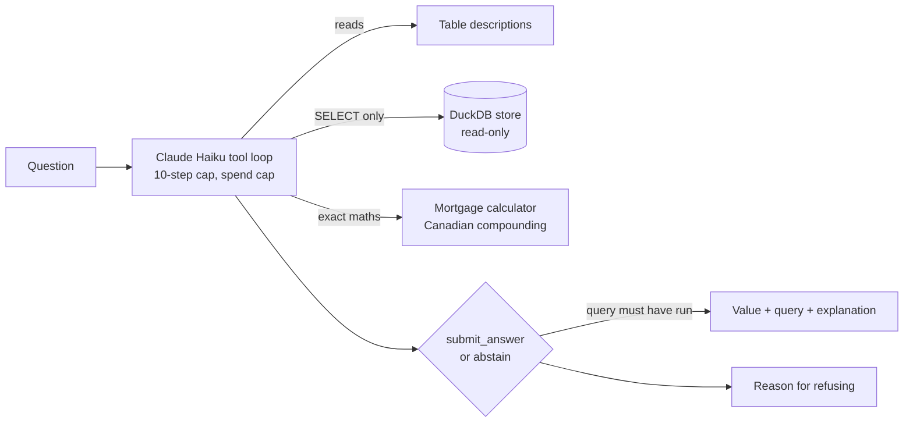

# open-data-analyst

**Ask a question about Canadian housing in plain English. A Claude agent writes read-only SQL, runs it, and answers with the number and the exact query, or says it can't.**

Built around one real question: *is it cheaper to rent or buy a 1-bedroom condo in Surrey, Burnaby or Vancouver?* The agent works over public data (Bank of Canada, Statistics Canada, CMHC) in a local DuckDB file, and it is judged against an eval set of exact answers, not by whether the output looks plausible.

## Results

| | Score | Confident-wrong answers | Cost |
|---|---|---|---|
| Always-abstain floor | 29% (12/41) | 0 | $0 |
| Claude Haiku 5.5, first live run | 37% | 26 | $0.096 per run |
| Claude Haiku 5.5, after fixes (3 runs) | 100%, 100%, 100% (41/41) | 0 | $0.088 to $0.094 per run, about $0.002 per question |
| **Claude Haiku 5.5, 22 unseen holdout questions, first run, no tuning** | **91% (20/22)** | 1 | $0.045 per run, $0.002 per question |
| Claude Haiku 5.5, after fixing the two holdout misses: 3 runs on the 41, one re-run on the 22 | 98%, 100%, 100% on the 41; 100% on the 22 (no longer unseen) | 1 in one of the 3 runs, 0 otherwise | about $0.09 per 41-question run |

How to read this: the first run looked bad, but 22 of its 25 wrong answers were correct numbers returned as text, so the strict scorer caught a tool-schema bug rather than a reasoning failure. After the fixes the agent got every question right three times in a row, but those 41 questions were tuned against, so that 100% shows consistency, not what to expect on new questions. The honest number is the holdout: 22 questions written afterwards and never used for tuning, scored once. It got 91%, with all 6 unanswerable questions correctly refused. The two misses (a yes/no answered with a number, and a Toronto rent question refused because the data is metro-wide) were then fixed with prompt changes; the 91% stays as the number to quote, because the 100% re-run is on questions that were used for the fix. Details in [docs/impact.md](docs/impact.md). With only 22 questions, one question is worth about 4.5 points, so treat 91% as roughly "high 80s to mid 90s".

## What an answer looks like

> **Q:** How much more or less per month is the mortgage payment on the Surrey 2025 new-condo average price (6.19%, 20% down, 25 years) than the Vancouver metro asking rent for a 1-bedroom?
>
> **A:** $851.11 more per month. Surrey's 2025 new apartment and condo sales (4,797 units) average about $601,078 using price-band midpoints, giving a $3,131.11 payment, against a metro-wide asking rent of $2,280. This excludes property tax, strata fees and insurance, and the average is an approximation because CMHC publishes counts by price band, not an average price.
> **Queries shown:** 5 read-only SQL queries, 7 steps, $0.007.

And when the data can't support an answer, it says so rather than guessing:

> **Q:** What is the average rent for a 2-bedroom apartment in Surrey?
>
> **A:** Abstains. The only rent source reports the whole Vancouver metro area, not individual cities, so any Surrey figure would be a substitution.

## How it works



- **Read-only by construction.** Three independent layers: the database connection is read-only, file and network access is disabled and locked, and only a single `SELECT` is accepted. Results are capped at 50 rows and 10 seconds.
- **Every answer shows its query.** An answer is rejected unless it cites a query that actually ran.
- **Abstains rather than guesses.** Running out of steps, a model refusal, or ending without a final tool all count as an abstention.
- **Maths is not left to the model.** Mortgage payments come from a tested function (Canadian semi-annual compounding, checked by amortizing the loan to zero).
- **Cheap on purpose.** Haiku for the loop, tokens and dollars logged for every question.

## How it is measured

- **Evals came before the agent.** The 41-question set and scorer existed, with a baseline, before any agent code was written.
- **Expected answers are derived, not typed.** Each carries the SQL that produced it, and `evals verify` re-derives all of them after a data refresh.
- **The scorer separates failure types.** A missed answer, a wrong answer and an answer to an unanswerable question (overreach) are different outcomes, because a confident wrong number is the worst failure.
- **A holdout set checks for tuning.** 22 further questions, written after the agent was tuned and scored once as written, so the score is not flattered by fixes made to the original set.
- **The main set mixes** 12 lookups, 12 calculations, 5 scope checks and 12 questions the data cannot answer.

## Use it from Claude Desktop (MCP)

The same tools are available as an MCP server, so Claude Desktop can query the data and draw charts directly. Add this to `claude_desktop_config.json`, with the path to your checkout:

```json
{
  "mcpServers": {
    "open-data-analyst": {
      "command": "uv",
      "args": ["--directory", "/path/to/open-data-analyst", "run", "python", "-m", "open_data_analyst.mcp_server"],
      "env": { "ANTHROPIC_API_KEY": "only needed for the ask tool" }
    }
  }
}
```

| Tool | What it does | Cost |
|---|---|---|
| `describe_schema` | Tables, columns and each table's limits | free |
| `run_sql` | One read-only SELECT, 50 rows, 10 seconds | free |
| `mortgage_payment` | Canadian semi-annual compounding | free |
| `make_chart` | Runs a SELECT and returns a Vega-Lite bar or line chart spec | free |
| `ask` | Runs the evaluated Haiku agent: answer plus its query, or a reason for declining | about $0.002 per question, capped at $0.25 per session |

With the free tools Claude Desktop does the reasoning itself, so the eval scores above describe `ask`, not Desktop's own answers. Every query goes through the same read-only store either way.

## Data

| Source | Used for |
|---|---|
| Bank of Canada Valet API | Posted 5-year mortgage rate, weekly |
| Statistics Canada table 46-10-0092-01 | Average asking and paid rent by metro area, quarterly |
| CMHC Market Absorption Survey | New-home sales by price band and municipality, 2016 to 2026 |
| Natural Resources Canada place names | Reference points for the 40 km scope rule |

Scope is every municipality within 40 km (straight line) of Waterfront Station. Source quirks found and handled are in [docs/impact.md](docs/impact.md), for example a discontinued rate series, overlapping CMHC files that would triple-count sales, and suppressed small counts. Every table and column is documented in [docs/data-dictionary.md](docs/data-dictionary.md).

## Data licences and attribution

Raw downloads are not committed; `data refresh` fetches them from the publishers. Numbers in this repo and in answers are derived from these sources, which are used under each publisher's terms:

| Source | Terms | Attribution |
|---|---|---|
| Statistics Canada, table 46-10-0092-01 | [Statistics Canada Open Licence](https://www.statcan.gc.ca/en/reference/licence) | Adapted from Statistics Canada, Asking rent and paid rent prices, by rental unit type and number of bedrooms, experimental estimates (table 46-10-0092-01), 2019 to April 2026. This does not constitute an endorsement by Statistics Canada of this product. |
| CMHC, Market Absorption Survey | [CMHC Licence Agreement for the Use of Data](https://www.cmhc-schl.gc.ca/en/professionals/housing-markets-data-and-research/housing-data/cmhc-licence-agreement-use-of-data) | Adapted from Canada Mortgage and Housing Corporation, absorbed units by price range, 2016 to 2026. This does not constitute an endorsement by CMHC of this product. |
| Bank of Canada, Valet API | [Bank of Canada terms](https://www.bankofcanada.ca/terms/) | Source: Bank of Canada, posted conventional mortgage rates (series V122521 and V80691335). Changes were made: values are loaded and combined with other data. |
| Natural Resources Canada, Canadian Geographical Names | Open Government Licence - Canada | Contains information licensed under the Open Government Licence - Canada. |

None of these publishers endorses this project. Statistics Canada and CMHC data is provided as is, with no warranty, and the Bank of Canada does not guarantee accuracy. The Bank of Canada's terms bar circumventing request limits, so the refresh fetches each series once.

## Limits

- Rents exist only for the whole Vancouver metro area, so city-by-city rent comparisons are refused.
- New-home prices come as bands, so prices are band-midpoint estimates. CMHC data is not split by bedroom count and does not cover resale.
- Not financial advice. Payments exclude property tax, strata fees and insurance.

## Run it

```
uv sync
uv run python -m open_data_analyst.data refresh      # download sources, build data/open_data.duckdb
uv run python -m open_data_analyst.evals verify      # re-derive every expected answer
uv run python -m open_data_analyst.evals baseline    # score the always-abstain floor
ANTHROPIC_API_KEY=... uv run python -m open_data_analyst.evals agent --max-cost 1
```

Development: `uv run ruff check . && uv run ruff format --check . && uv run pytest` (60 tests).

## Project notes

- [docs/plan.md](docs/plan.md) - phases and status
- [docs/decisions.md](docs/decisions.md) - every design decision with options and trade-offs
- [docs/impact.md](docs/impact.md) - per-phase results
- Sibling project: [support-desk-assistant](https://github.com/vdrohan/support-desk-assistant) answers from documents; this one answers from structured data using tools.
